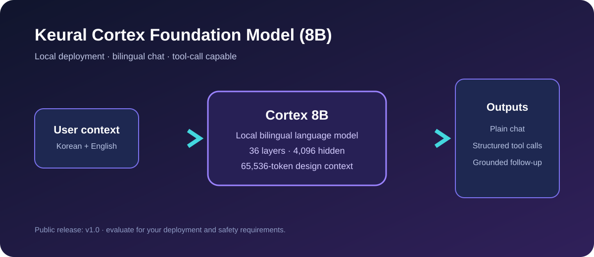
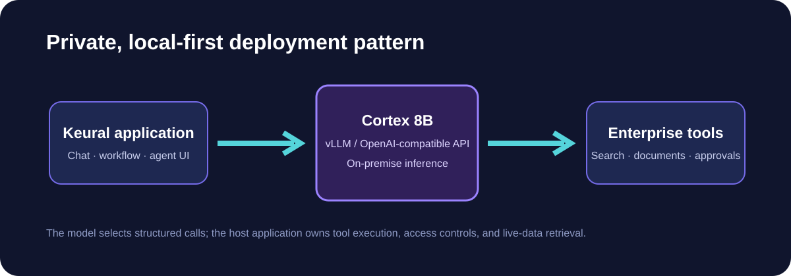
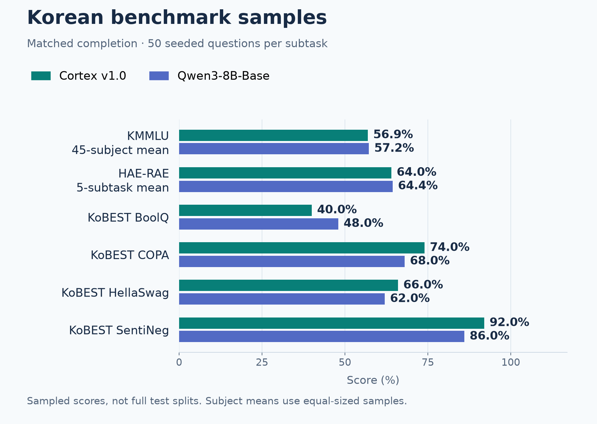
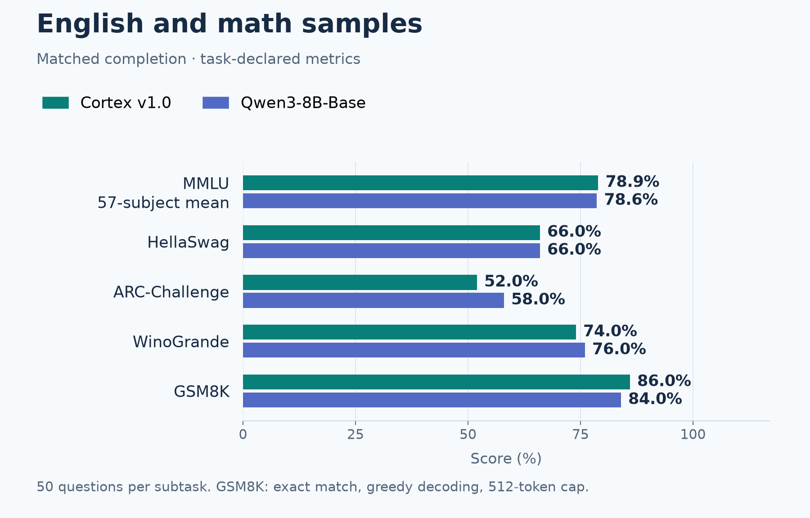
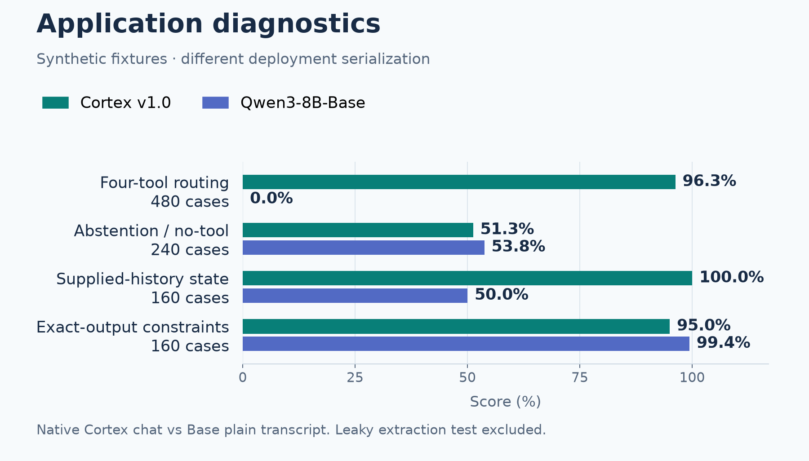
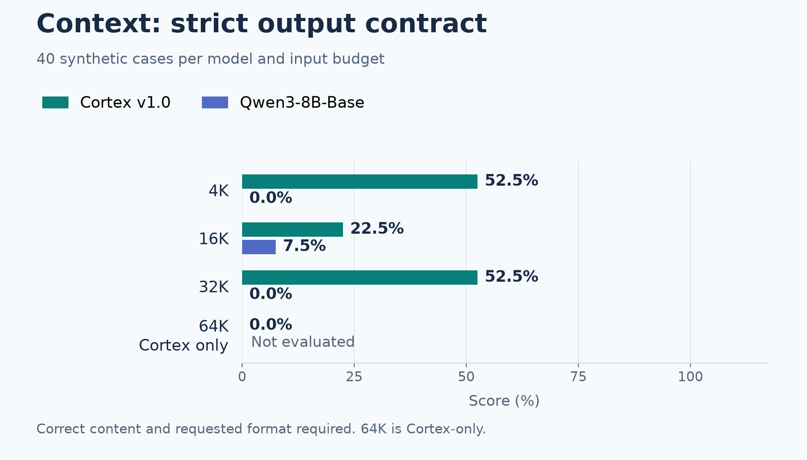
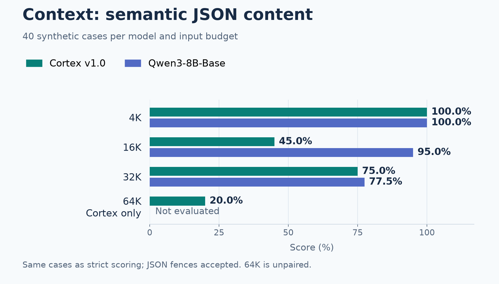

# Keural Cortex 8B v1.0

**Korean–English · instruction and tool tuning · local deployment · Apache 2.0**

Keural Cortex is an 8B-parameter model based on Qwen3-8B-Base, adapted through continued training, instruction tuning, preference optimization and agent/tool-contract tuning for Keural enterprise workflows.

<p align="center"></p>

[Model overview](#model-overview) · [Evaluation](#evaluation) · [Deployment](#quick-start-vllm) · [Limitations](#limitations) · [Reproducibility](#reproducibility)

> **Public v1.0 release.** Deploy and evaluate within your own data, authorization, safety and performance requirements. The host application executes tools and controls access; the model generates proposed responses and tool calls.

## Model overview

| Property | Specification |
|---|---|
| Base model | [Qwen3-8B-Base](https://huggingface.co/Qwen/Qwen3-8B-Base) |
| Architecture | Decoder-only transformer; 36 layers |
| Hidden size | 4,096 |
| Attention heads / KV heads | 32 / 8 |
| Vocabulary | 151,936 tokens |
| Languages | Korean and English |
| Weights | BF16 SafeTensors, approximately 16 GB |
| Configured position limit | 65,536 tokens; see context evaluation for measured limitations |
| License | Apache 2.0, with applicable upstream notices |

**한국어.** Keural Cortex는 한국어·영어 업무 대화와 구조화된 도구 호출을 위해 조정된 8B 모델입니다. 모델은 응답과 도구 호출을 제안하며, 실제 도구 실행과 데이터 접근 권한은 호스트 애플리케이션에서 관리합니다. 아래 평가는 표본 기반 벤치마크와 합성 진단을 구분하여 보고합니다.

## Intended use

- Korean–English assistants in customer-controlled infrastructure.
- Structured call generation for `search_web`, `fetch_web_urls`, `retrieve_documents` and `ask_clarification`, when provided by the application.
- Local inference behind an OpenAI-compatible endpoint, with server-side authorization, schema validation and audit logging.

The model does not independently browse the web, access private documents or execute external actions. Native function-call integration and inference behavior depend on the serving stack and application contract.

<details>
<summary>Architecture and application-controlled deployment</summary>

<p align="center"></p>

<p align="center"></p>
</details>

## Evaluation

**Completed November 10, 2026 · 39/39 jobs · 14,340 evaluated scenarios across both checkpoints.** The baseline is **Qwen3-8B-Base**, not the instruction-tuned Qwen3-8B release. These are sampled benchmarks and synthetic diagnostics—not a full-test-split leaderboard submission or a claim of overall superiority.

Scores below are percentages; differences are percentage points. Figures use the same scale and model colors throughout. Standard completion, application diagnostics and context probes are reported separately.

### Korean-language benchmarks

Both models use matched raw-completion prompts and the same frozen examples: 50 seeded questions per subtask, including 45 KMMLU subjects and five HAE-RAE subtasks. Subject/subtask means use equal-sized samples. This panel covers 2,700 Korean questions per model.

<p align="center"></p>

<details>
<summary>Exact Korean scores and metric definitions</summary>

| Benchmark / diagnostic | Cortex v1.0 | Qwen3-8B-Base | Difference |
|---|---:|---:|---:|
| KMMLU · 45-subject mean | 56.93% | 57.24% | -0.31 pp |
| HAE-RAE · 5-subtask mean | 64.00% | 64.40% | -0.40 pp |
| KoBEST BoolQ | 40.00% | 48.00% | -8.00 pp |
| KoBEST COPA | 74.00% | 68.00% | +6.00 pp |
| KoBEST HellaSwag | 66.00% | 62.00% | +4.00 pp |
| KoBEST SentiNeg | 92.00% | 86.00% | +6.00 pp |

KMMLU, BoolQ, COPA and SentiNeg use accuracy. HAE-RAE and KoBEST HellaSwag use normalized accuracy. KMMLU has 2,250 questions per model; HAE-RAE has 250; each KoBEST task has 50.
</details>


Cortex improves the sampled COPA, HellaSwag and SentiNeg results. BoolQ declines, and the KMMLU and HAE-RAE means are slightly below Base. These mixed results do not establish broad Korean-language superiority or statistical significance.

### English and math benchmarks

The same completion protocol covers 57 MMLU subjects and four additional benchmarks, with 50 seeded questions per subtask: 3,050 English/math questions per model.

<p align="center"></p>

<details>
<summary>Exact English/math scores and metric definitions</summary>

| Benchmark / diagnostic | Cortex v1.0 | Qwen3-8B-Base | Difference |
|---|---:|---:|---:|
| MMLU · 57-subject mean | 78.95% | 78.63% | +0.32 pp |
| HellaSwag | 66.00% | 66.00% | 0.00 pp |
| ARC-Challenge | 52.00% | 58.00% | -6.00 pp |
| WinoGrande | 74.00% | 76.00% | -2.00 pp |
| GSM8K | 86.00% | 84.00% | +2.00 pp |

MMLU and WinoGrande use accuracy; HellaSwag and ARC-Challenge use normalized accuracy. GSM8K uses strict extracted exact match, greedy decoding and a 512-token output cap. MMLU has 2,850 questions per model; each other task has 50.
</details>


MMLU and GSM8K show small gains; HellaSwag is tied; ARC-Challenge and WinoGrande decline. Differences are descriptive sample results, not significance tests.

### Application diagnostics

These bilingual fixtures are template-generated, not independently authored holdout benchmarks. Cortex uses its native chat/tool template; Base uses a documented plain-transcript wrapper. Both receive the same requests, schemas, example content and evidence. Generation is greedy, with a 128-token cap, repetition penalty 1.0 and declared stop boundaries. No live external tools execute.

<p align="center"></p>

<details>
<summary>Exact application scores and sample counts</summary>

| Benchmark / diagnostic | Cortex v1.0 | Qwen3-8B-Base | Difference |
|---|---:|---:|---:|
| Four-tool routing + declared arguments · n=480 | 96.25% | 0.00% | +96.25 pp |
| Abstention / no-tool exact answer · n=240 | 51.25% | 53.75% | -2.50 pp |
| State tracking from supplied history · n=160 | 100.00% | 50.00% | +50.00 pp |
| Exact-output constraints · n=160 | 95.00% | 99.38% | -4.38 pp |

</details>


Routing measures this specific contract and wrapper. A zero Base score does not imply that a pretrained model can never produce tool-shaped text. Argument checks are deterministic but incomplete; supplied-history state tracking does not measure autonomous agent execution.

**Excluded diagnostic:** the original `Tool-result grounding` fixture scored 100% for both models, but its answer also appears in the user ticket ID and the citation is supplied. It is simple extraction with answer leakage, not isolated grounding evidence. It is omitted from these application figures and capability claims; original outputs remain in the audit archive.

### Context diagnostics

Each budget has 40 bilingual synthetic cases per evaluated model. The same cases have two scoring views, shown in separate figures for clarity.

**Strict output contract:** requires correct content, the requested JSON format and completion within the output budget.

<p align="center"></p>


**Semantic JSON content:** checks expected values while accepting JSON fences. This is a second scoring view of the same responses, not additional independent evidence.

<p align="center"></p>

<details>
<summary>Exact context scores</summary>

| Input budget | Cortex strict | Base strict | Cortex semantic | Base semantic |
|---|---:|---:|---:|---:|
| 4K | 52.50% | 0.00% | 100.00% | 100.00% |
| 16K | 22.50% | 7.50% | 45.00% | 95.00% |
| 32K | 52.50% | 0.00% | 75.00% | 77.50% |
| 64K | 0.00% | Not evaluated | 20.00% | Not evaluated |

</details>


The configured 65,536-token position limit is not a guarantee of retrieval accuracy. Cortex-only 64K scored **0% strict and 20% semantic**; no paired Base win/loss is claimed. These probes are not RULER or LongBench results and do not establish reliable long-document reasoning.

## Reproducibility

<details>
<summary>Methodology, exact revisions, and reproduction artifacts</summary>

| Setting | Recorded value |
|---|---|
| Evaluated Cortex checkpoint | `mkd-hossain/Keural-Cortex-8B-v1.0` at `a592a43fe940299b5a025e5b719459cda97ae1e6` |
| Evaluated Base checkpoint | `Qwen/Qwen3-8B-Base` at `49e3418fbbbca6ecbdf9608b4d22e5a407081db4` |
| Run identifier | `runs-full-budget-v1` |
| Hardware / precision | NVIDIA DGX Spark, GB10; BF16; no weight quantization |
| Runtime | PyTorch 2.11.0+cu130; Transformers 4.57.6; lm-evaluation-harness 0.4.12 |
| Standard sampling | Fixed seed 20261110; 50 randomly selected examples per leaf task; frozen dataset files, indices and source metadata |
| Few-shot settings | 5 for KMMLU, HAE-RAE, MMLU and GSM8K; 0 for the other standard tasks |
| Standard evaluation seeds | Python 0; NumPy, Torch and few-shot seed 1234 |
| Math generation | Greedy; 512 new tokens; repetition penalty 1.0; batch size 1 |
| Deployment / context generation | Greedy; 128 new tokens; repetition penalty 1.0; fixed example content; declared EOS / stop boundaries |
| Effective positional configuration | Cortex: theta 1,000,000, YaRN factor 2, original context 32,768; Base: original default rotary configuration |

**Runtime compatibility.** The evaluated Cortex export stores positional settings under `rope_parameters`. The pinned evaluation runtime required an explicit translation into its legacy `rope_theta` / `rope_scaling` fields. The actual rotary type and effective configuration were asserted before inference. Repository generation-default inheritance was disabled, and effective generation settings were recorded. These are inference-configuration corrections, not weight modifications. Earlier pilots with configuration or decoding issues are preserved separately and are not the scores reported here.

**Coverage and independence.** The completed plan contains 11,500 standard questions across both models, 2,560 synthetic domain scenarios, 240 paired context scenarios, and 40 Cortex-only extension scenarios. Template-based variants are correlated; training overlap has not been fully ruled out. The original runtime deadline saved a partial run; user-authorized continuation completed the unchanged scenario plan. Completed artifacts and protocol hashes were checked before resuming. There is no claim of independent certification, statistical significance, production readiness or comparability with provider-published leaderboard numbers.

- [Evaluation source and protocol](methodology/PROTOCOL.md)
- [Frozen dataset identities and exact indices](evaluation/frozen-standard-manifest.json)
- [Final status and job inventory](results/run/state.json)
- [Final descriptive summary](results/final-summary.json)
- [All saved results and responses](results/run)
- [Model, tokenizer and environment checksums](evaluation/environment-provenance.json)
- [Standard subject scores (CSV)](results/standard-subtasks.csv)
- [Audit findings and known limitations](methodology/AUDIT.md)

</details>


## Quick start: vLLM


```bash
vllm serve <MODEL_PATH> \
  --served-model-name keural-cortex-8b-v1.0 \
  --tool-call-parser hermes \
  --enable-auto-tool-choice
```

For text-only chat, send a normal OpenAI Chat Completions request **without** `tools` or `tool_choice`. For agent workflows, provide only the tools your application authorizes, validate all tool arguments server-side, and execute calls outside the model process.

## Example tool contract

```json
{
  "type": "function",
  "function": {
    "name": "retrieve_documents",
    "description": "Search content in the user's available documents.",
    "parameters": {
      "type": "object",
      "properties": {
        "query": {"type": "string"},
        "file_ids": {"type": "array", "items": {"type": "string"}},
        "exhaustive": {"type": "boolean"}
      },
      "required": ["query"]
    }
  }
}
```


Verify the effective positional configuration and generation settings in your serving runtime. The evaluation used an explicitly checked RoPE compatibility adapter; see the methodology above. Set serving memory and context limits for your own workload.

<details>
<summary>Release-environment serving smoke checks</summary>

The following were verified through vLLM's OpenAI-compatible API in the release environment:

- Plain Korean chat returned a direct answer without emitting a tool call.
- A current-information request generated a structured `search_web` call.
- An exhaustive document request generated `retrieve_documents` with `exhaustive: true`.
- An underspecified revision request generated `ask_clarification` with a question and checklist.

These are smoke tests, not a substitute for domain-specific benchmarking or safety evaluation.
</details>


## Limitations

- Outputs can be inaccurate, inconsistent or fabricated. Validate important information and all external actions.
- Standard evaluation uses sampled questions, not complete official test splits. Synthetic cases are correlated template variants, and training overlap has not been fully ruled out.
- Deployment diagnostics use different serializations for the instruction-tuned Cortex checkpoint and pretrained Base checkpoint. No overall ranking or statistical significance is claimed.
- The excluded extraction fixture contains answer leakage. Its 100% score is not evidence of grounding or tool-calling capability.
- Context results show formatting and content failures, including limited 64K retrieval performance. Do not infer reliable long-context behavior from the configuration limit alone.
- Tool calls are suggestions. The application must enforce schemas, authorization, user intent, logging and safe execution.
- Do not use this model as the sole basis for high-stakes medical, legal, financial, safety, employment, credit or access-control decisions.

## License and attribution

Keural Cortex v1.0 is based on Qwen3-8B-Base and released under Apache 2.0. Retain applicable upstream notices and comply with the model and dependency license terms. This model card does not claim independent certification or universal production readiness.

<details>
<summary>Version and release policy</summary>

Keural Cortex uses a two-track version policy:

- **Development versions** progress with each internal training milestone: `v1.0 → v1.1 → v1.2 → … → v1.5`.
- **Public versions** are released only after an internal version is validated as stable. This initial Hugging Face publication is **v1.0**; a later validated internal milestone may be published as a public version such as **v1.5**.
</details>


## Citation

```bibtex
@misc{keural-cortex-8b-v1.0,
  title={Keural Cortex Foundation Model (8B) — v1.0},
  author={MKD AI},
  year={2026},
  publisher={Hugging Face}
}
```


## Follow-up training history

The author reports that a later training effort was discontinued before completion due to compute/resource limitations. This effort is separate from the released v1 checkpoint. No improvements from unfinished training are attributed to these evaluation results. See [project history](methodology/PROJECT_HISTORY.md).
