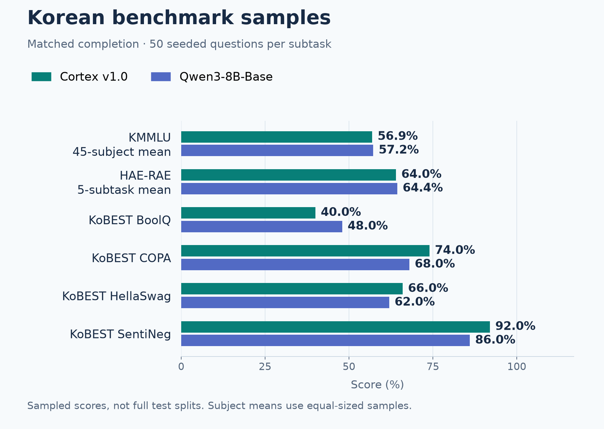
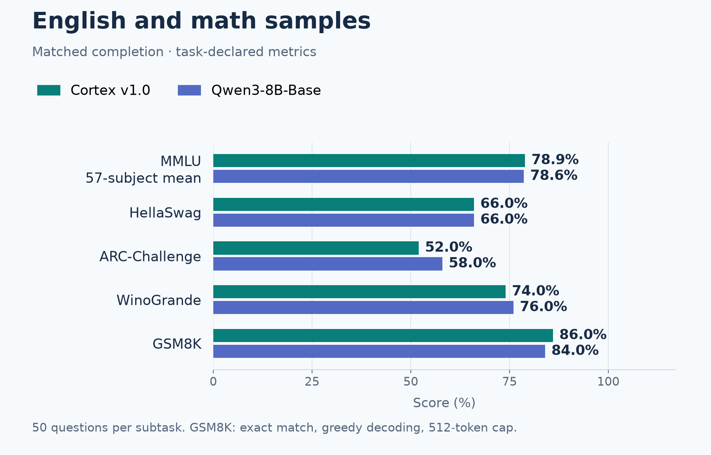
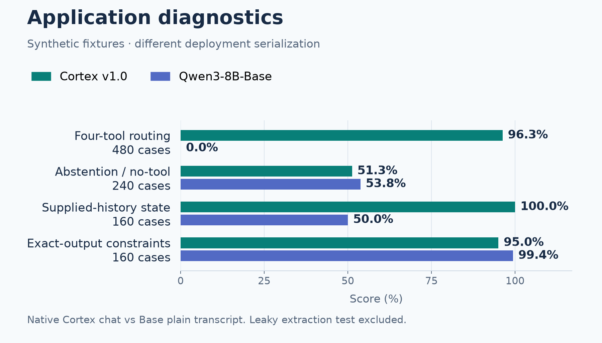

# Keural Cortex v1.0 — benchmark evaluation

**Completed, auditable comparison against Qwen3-8B-Base.** This repository contains the final v1 evaluation, its source, recorded outputs and a permanent, read-only Evaluation Lab.

### [Open Benchmark Evaluation Lab](https://mkd-hossain.github.io/Cortex-v1.0-evaluation/)

[Model card](MODEL_CARD.md) · [PDF report](docs/downloads/benchmark-report.pdf) · [Graphs](https://mkd-hossain.github.io/Cortex-v1.0-evaluation/#graphs) · [CSV scores](results/standard-subtasks.csv) · [Raw evidence](results/run/) · [Audit](methodology/AUDIT.md)

The website is a static archive hosted by GitHub Pages. Viewing results, charts, recorded logs and downloads requires **no DGX Spark, Tailscale, SSH or running evaluation server**. The original Spark dashboard address is not a permanent hosting address.

## What was evaluated

| Item | Recorded scope |
|---|---|
| Custom checkpoint | `mkd-hossain/Keural-Cortex-8B-v1.0` at `a592a43fe940299b5a025e5b719459cda97ae1e6` |
| Comparator | `Qwen/Qwen3-8B-Base` at `49e3418fbbbca6ecbdf9608b4d22e5a407081db4` |
| Completion | 39/39 jobs; completed November 10, 2026 |
| Standard tasks | 115 subtasks, 50 seeded questions per subtask per model |
| Deployment fixtures | 1,280 bilingual synthetic scenarios per model |
| Context | 40 cases per model at each paired 4K/16K/32K budget; 40 additional Cortex-only 64K cases |
| Total | 14,340 evaluated scenarios across both checkpoints |
| Hardware / precision | NVIDIA DGX Spark GB10 / BF16 |

Only **Qwen3-8B-Base** is the comparator in this release. Earlier pilots and assistant comparisons are not part of the current repository contents; previous work remains in Git history.

## Results at a glance

| Standard benchmark | Cortex v1.0 | Qwen3-8B-Base |
|---|---:|---:|
| KMMLU — 45-subject mean | 56.9% | 57.2% |
| HAE-RAE — 5-subtask mean | 64.0% | 64.4% |
| KoBEST BoolQ | 40.0% | 48.0% |
| KoBEST COPA | 74.0% | 68.0% |
| KoBEST HellaSwag | 66.0% | 62.0% |
| KoBEST SentiNeg | 92.0% | 86.0% |
| MMLU — 57-subject mean | 78.9% | 78.6% |
| HellaSwag | 66.0% | 66.0% |
| ARC-Challenge | 52.0% | 58.0% |
| WinoGrande | 74.0% | 76.0% |
| GSM8K | 86.0% | 84.0% |

These are sampled results, **not full official test-set scores**. Subject means are unweighted; metrics differ between benchmarks. See the CSV and model card for metric definitions. No overall winner or statistical significance is claimed.

## Deployment and context findings

Cortex passed 462/480 four-tool routing fixtures (96.3%); Base passed 0/480 under the recorded schema and parser. This measures compliance with this tool contract and does not establish that a base model can never generate tool-like text. Cortex uses its native chat template; Base uses a plain transcript with the same requests, demonstrations, schemas and generation budget. This is a deployment comparison with different serialization, not an identical-format capability comparison.

Cortex also improved supplied-history state following, while Base scored higher on abstention/no-tool and exact instruction constraints. The supplied-tool-result extraction fixture has answer leakage: its 100% results are preserved for audit but excluded from grounding claims and default graphs. Context content recovery and strict JSON compliance are shown separately; the Cortex-only 64K extension has no paired Base score.

[Strict context graph](assets/model-card/context-strict.png) · [Semantic context graph](assets/model-card/context-semantic.png)

## Model and project history

This archive evaluates the released **v1.0 checkpoint**, without updating its weights. The model author reports that a later follow-up training effort was discontinued before completion because of compute/resource limitations. That unfinished effort is separate from this checkpoint and these evaluation results; no improvements from it are attributed to v1.0. See [project history](methodology/PROJECT_HISTORY.md).

## Reproducibility and limitations

- [Evaluation source and reproduction guide](evaluation/README.md), [frozen sample manifest](evaluation/frozen-standard-manifest.json), [plan](evaluation/plan.json), and [recorded environment](evaluation/environment-provenance.json).
- [Final summary](results/final-summary.json), [all presentation metrics](results/dashboard-data.json), and [per-job raw records and logs](results/run/).
- [Runtime/configuration audit](methodology/AUDIT.md): corrected RoPE adapter, explicit decoding settings, synthetic extraction leakage, prompt-format differences and interpretation limits.
- Synthetic fixtures are template-generated development validation, not an independently authored holdout. Training contamination clearance, broad production readiness and an overall model ranking are not established.
- The original runtime deadline stopped the run partway through. Continuation was explicitly authorized; all 39 jobs subsequently completed. A completed run does not imply that every test passed.

The repository publishes evaluation artifacts, not model weights, private training datasets, credentials or private training source. Upstream dataset/software terms still apply; see [NOTICE](NOTICE.md). `SHA256SUMS` verifies the bytes in this release, separately from historical manifests recorded during inference.

## Viewing locally

Open `docs/index.html` directly, or serve `docs/` with `python -m http.server 8000 --directory docs`. Data and logs are local JavaScript assets; no Spark API is queried. Recorded logs are historical, not live telemetry.
